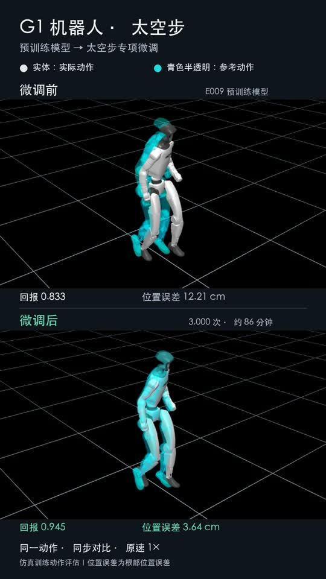

# G1 Moonwalk with SuperMimic

基于 **SuperMimic_Dyn 第三方复现**的 G1 太空步微调小实验：E009 预训练权重 → 单条 CMU 太空步动作 → 闭环仿真评估。

**非 SuperMimic 官方实现，非 KAIST 官方动作；不是从零训练，也未验证真机。**

[▶ 手机竖屏对比视频（上：微调前；下：微调后）](media/comparison_portrait.mp4) · [微调前原视频](media/baseline.mp4) · [微调后原视频](media/finetuned.mp4)

[](media/comparison_portrait.mp4)

视频实色机器人是闭环仿真的实际动作，青色半透明是参考动作；原速 1×。渲染从真实 rollout 轨迹回放，不是把参考动画当成策略效果。

## 结果

单张 A800-SXM4-80GB，3,000 次迭代，训练 **5,159.7 秒（约 86 分钟）**；包含基线、检查点评估与渲染约 91 分钟。训练 1,174 个 update groups，峰值 PyTorch reserved 显存约 2.88 GiB（不包含所有仿真/驱动分配）。

| 检查点 | 完成步数 | 完整动作归一化回报 ↑ | 根部位置误差 ↓ | 关节 RMSE ↓ | 根部姿态误差 ↓ |
|---|---:|---:|---:|---:|---:|
| E009 微调前 | 300/300 | 0.8329 | 0.1221 m | 0.1719 rad | 0.1264 rad |
| 微调 1,000 | 300/300 | 0.9158 | 0.0653 m | 0.1360 rad | 0.1042 rad |
| 微调 2,000 | 300/300 | 0.9446 | 0.0403 m | **0.1350 rad** | 0.0722 rad |
| **微调 3,000（选中）** | 300/300 | **0.9453** | **0.0364 m** | 0.1355 rad | **0.0707 rad** |

选择规则：在微调检查点中，优先未失败、完成比例，再比较归一化回报。因此选中 3,000 次，不代表它在每项误差上都最好。

**这是一条训练动作的拟合评估，单种子、单次 rollout；不是测试集泛化成绩或真机成功率。** 完整数值见 [results/comparison.json](results/comparison.json)，历史配置见 [results/training_config.json](results/training_config.json)。公开包装移除了机器路径；数值未改。

## 安装（Linux + NVIDIA GPU）

要求 Python 3.12、Git、可用的 NVIDIA 驱动和 EGL；推荐 Ubuntu 22.04。系统还需 C/C++ 编译器、Python 3.12 开发头文件（Python.h）和 OpenGL/EGL 运行库。此实验测试硬件为 A800，显存数字不等于最低硬件要求。

```bash
git clone https://github.com/luoshaqi/g1-moonwalk-supermimic.git
cd g1-moonwalk-supermimic
bash scripts/setup.sh
export SUPERMIMIC_ROOT="$PWD/upstream"
source scripts/env.sh
export CUDA_VISIBLE_DEVICES=0 MUJOCO_EGL_DEVICE_ID=0 MUJOCO_GL=egl
```

脚本固定上游 commit `28b15acb68ab3871f2ae1479964d53457ac066c6`，安装其 vendored mjlab、PyTorch 2.14.1/cu126、MuJoCo 3.16.0、Warp 1.17.0。复用环境时设置 `SUPERMIMIC_ROOT` 并使用该环境的 Python；不要复制另一台机器的 `.venv`。GPU 可见编号与 EGL 物理设备编号需按本机配置匹配。

## 下载预训练权重

先阅读 [来源与许可](THIRD_PARTY_NOTICES.md)，尤其是 E009 模型卡；本仓库 MIT 许可仅覆盖代码，不授予权重或数据的额外权限。

```bash
.venv/bin/python scripts/download_checkpoint.py
```

脚本核对 E009 SHA-256：`182b7a5d05b6c3e4364d6223d1cf52ba18e6573563e961f6e019d6d445340c3c`。权重采用 PyTorch pickle 格式，仅加载可信来源。权重不随仓库发布。

## 一次运行：微调 → 评估 → 视频

```bash
.venv/bin/python scripts/pipeline.py --output outputs/moonwalk
```

默认使用仓库内 `data/cmu90_32_moonwalk.npz`（50 Hz，301 帧，6 秒），先评估 E009，再微调 3,000 次，评估 1,000/2,000/3,000，选择最佳微调版，渲染前后视频。输出：

- `outputs/moonwalk/logs/moonwalk/`：配置、TensorBoard、检查点、训练摘要。
- `outputs/moonwalk/status.json`：运行阶段或错误信息。
- `outputs/moonwalk/delivery/`：`baseline.mp4`、`finetuned.mp4`、`comparison.json`。

需要使用新的输出目录，避免覆盖已有结果。`--stage evaluate --run-dir /path/to/existing/run --output outputs/reeval` 可跳过训练，重做评估和渲染。若只完成部分训练，可加 `--eval-iterations 1000` 等已存在迭代号。不会自动续训或覆盖原检查点。

默认超参：1,024 环境、world/policy batch 512、三网络学习率均 5e-5、seed 0、full689 goal、930 obs、29 action、`g1_no_plastic_hands`、不启用 torch.compile。严格加载世界模型、actor、critic 的预训练参数；**重置优化器、回放缓存、动作采样器和迭代计数**。保留上游其余默认配置，完整配置由训练器写出。

## 先做短检查

```bash
.venv/bin/python scripts/finetune.py \
  --checkpoint checkpoints/ckpt_0040000.pt \
  --iterations 70 --num-envs 64 --batch-size 64 \
  --run-name smoke
```

这只验证预训练加载、仿真、优化更新和保存是否可用，不用于比较动作效果。要复现表格，运行完整默认设置；更改种子、软件栈或硬件不保证逐位相同结果。

## 重新生成参考动作 / 制作竖屏视频

见 [docs/REPRODUCTION.md](docs/REPRODUCTION.md)。提供 ASF/AMC 解码、G1 重定向和上下对比视频脚本。原始动作属于 CMU，不是 KAIST 的太空步数据。

## 上游与许可

训练算法、环境与评估器来自 [Baojch/SuperMimic_Dyn](https://github.com/Baojch/SuperMimic_Dyn)，继承 [CuboiLeo/SuperMimic-Reproduced](https://github.com/CuboiLeo/SuperMimic-Reproduced)。方法来源：[SuperMimic](https://arxiv.org/abs/2610.28480)。本仓库提供单动作微调包装、CMU/G1 重定向、跟随相机及实验结果，不将继承组件作为原创。

代码：MIT；动作数据、权重、机器人资产和媒体另见 [THIRD_PARTY_NOTICES.md](THIRD_PARTY_NOTICES.md)。

English summary: An independent G1 moonwalk fine-tuning experiment built on the third-party SuperMimic_Dyn E009 implementation. Includes portable train/evaluate/render wrappers, the retargeted CMU 90_32 clip, reproduction instructions and before/after videos. Results measure fitting of one training motion in simulation, not generalization or real-robot performance.
